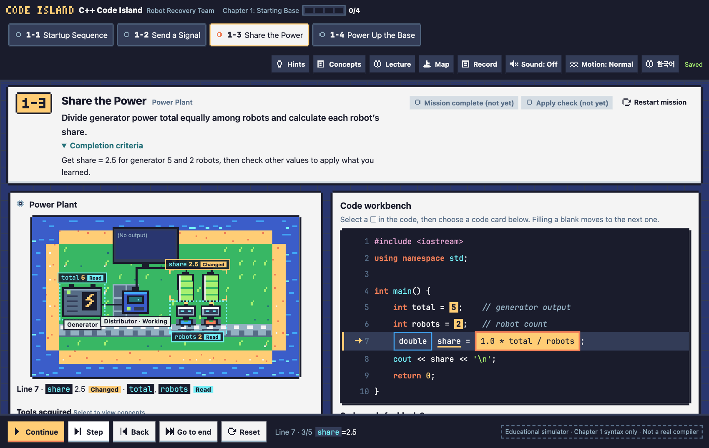
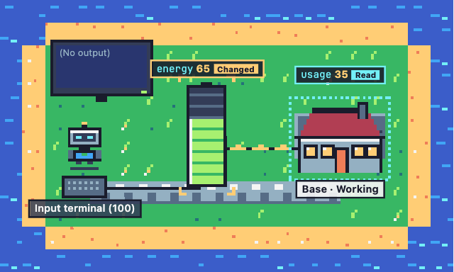
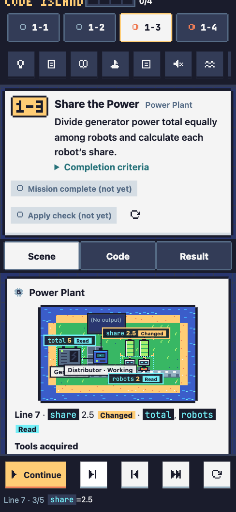

<p align="right"><a href="./README.md">한국어</a> | <b>English</b></p>

# C++ Code Island: Robot Recovery Team

A pixel-art puzzle game for C++ beginners. You run code one line at a time and watch robots and facilities react, so you learn what each statement does and when to use it. The missions follow the lecture order of MIT OpenCourseWare [6.096 Introduction to C++](https://ocw.mit.edu/courses/6-096-introduction-to-c-january-iap-2011/).

**[Play now](https://kmmugyum.github.io/cpp-code-island/?lang=en)** (runs in the browser, nothing to install)



## What the game does

You repair a broken island with C++. Every time a line runs, the game highlights three things together: the line being executed, the objects in the scene it affected, and the values that changed in the variable table.

- **Changed vs. read-only.** Running `double share = 1.0 * total / robots;` fills the robots' batteries (`share`), while the generator (`total`) and the robot count (`robots`) are only marked as *read*.
- **Output doesn't change state.** A `cout` line updates the output screen only; nothing else in the scene moves.
- **Predict before you run.** Pick what `5 / 2` and `5 / 2.0` will print, then run them and compare.
- **Re-check with other inputs.** An answer that only fits the first input (e.g. `total / 2.0`) is exposed when the generator or robot count changes.
- **Jump straight to the fix.** On a wrong answer, focus moves to the blank or code line that caused it.

<p align="center"></p>

## Missions (Chapter 1: Starting Base)

| Mission | Goal | Covers |
|---|---|---|
| 1-1 Startup Sequence | Connect the build machines in order to start the base | source, preprocessor, compiler, linker, executable |
| 1-2 Send a Signal | Show `READY` on the control screen | `main`, `cout`, `;`, case sensitivity, `using namespace std` |
| 1-3 Share the Power | Share power equally between robots | integer vs. floating-point division, `int` vs. `double`, evaluation order |
| 1-4 Power Up the Base | Subtract usage from the input power and print what's left | `cin >>`, assignment, fixing compile errors |

The island map shows all 10 lectures of 6.096. Chapter 1 is playable today; the rest will be added in lecture order.

## Controls

| Action | Mouse / touch | Keyboard |
|---|---|---|
| Run / pause | Run button in the bottom bar | `K` |
| Step forward / back | Step, Back | `N` / `B` |
| Reset to the start | Reset | `R` |
| Fill a blank | Tap a ▢ in the code, then pick a code card below | `Tab` to move, `Enter` to pick |
| Run after editing (1-4) | Run button | `Ctrl`/`⌘` + `Enter` |

No action requires dragging. On phones the screen is split into [Scene / Code / Result] tabs. Sound is off by default, and reduced motion follows both your OS setting and the top-bar button. Switch between Korean and English with the language button in the top bar or with `?lang=en` / `?lang=ko` in the URL.

<p align="center"></p>

## Progress and records

Progress is saved in your browser's storage. There is no server, so to share it with a tutor, download the progress file (`.json`) or the tutor summary (`.txt`) from **Record** in the top bar. The record keeps mission completion separate from the apply check (trying other inputs), along with the last hint level opened, error types, and the learner's one-line explanation.

## Not a real C++ compiler

The in-game runner is an educational simulator for Chapter 1 syntax only (`#include <iostream>`, `int`/`double`/`char`/`bool`, arithmetic and `%`, assignment, `cin`, `cout`, `endl`, `return`). For every code combination used in the missions, its output and its compile/link error split were checked against `clang++` (C++17). Undefined behavior such as reading an uninitialized variable never shows a made-up value; the simulator stops and explains instead.

## Development

Requires Node.js 22 or later (no external packages).

```bash
git clone https://github.com/kmmugyum/cpp-code-island.git
cd cpp-code-island
npm test          # simulator and mission grading tests
npm run build     # bundle everything into dist/cpp-code-island.html
```

While developing, open `src/index.html` directly in a browser. `npm run build` produces `dist/cpp-code-island.html`, a single file with all CSS, scripts, and graphics inside, so you can share just that one file.

```
src/
  cppsim.js     Chapter 1 C++ simulator (tokenizer, parser, step-by-step trace)
  missions.js   mission data and grading (no DOM, used by Node tests)
  i18n.js       Korean/English UI strings
  pixel.js      palette, sprites, 3x5 pixel font, icons
  scene.js      integer-scale canvas scene engine and per-mission scenes
  sfx.js        WebAudio sound effects
  app.js        UI, run controls, progress storage
tests/          node:test tests
build.mjs       single-file HTML bundler
```

The scene is drawn only from the current execution step and the time since that step started. Rapid clicking, stepping back, resetting, or switching missions never leaves the picture out of sync with the trace.

## Credits and license

- Code: [MIT License](./LICENSE)
- Lectures: MIT OpenCourseWare, *6.096 Introduction to C++*, January IAP 2011, licensed [CC BY-NC-SA 4.0](https://creativecommons.org/licenses/by-nc-sa/4.0/). The lecture files are not included in this repository. The in-game "Lecture" panel quotes short passages from the lecture notes with attribution. This game is an independent learning design based on the course; it is not made or endorsed by MIT.
- Graphics and sound: no external image or audio files. Everything is drawn and synthesized in code (`src/pixel.js`, `src/sfx.js`). Colors come from the [Sweetie 16](https://lospec.com/palette-list/sweetie-16) palette by GrafxKid.
