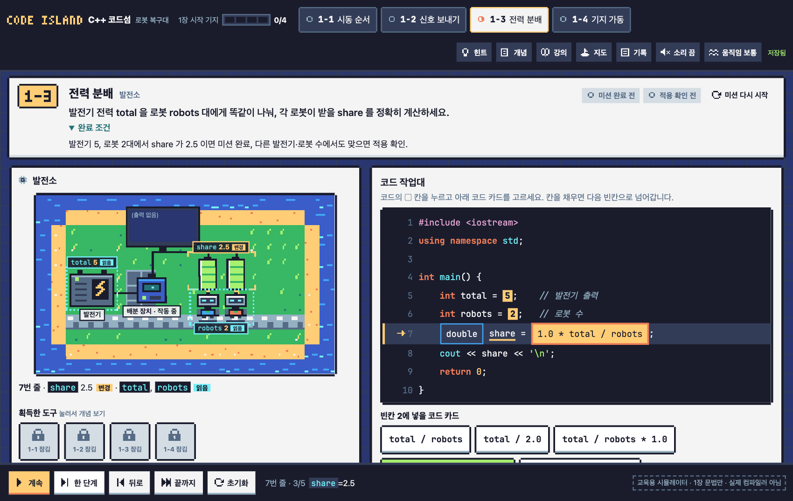
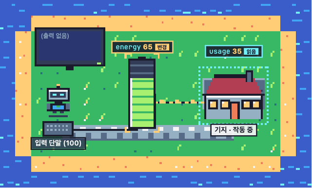
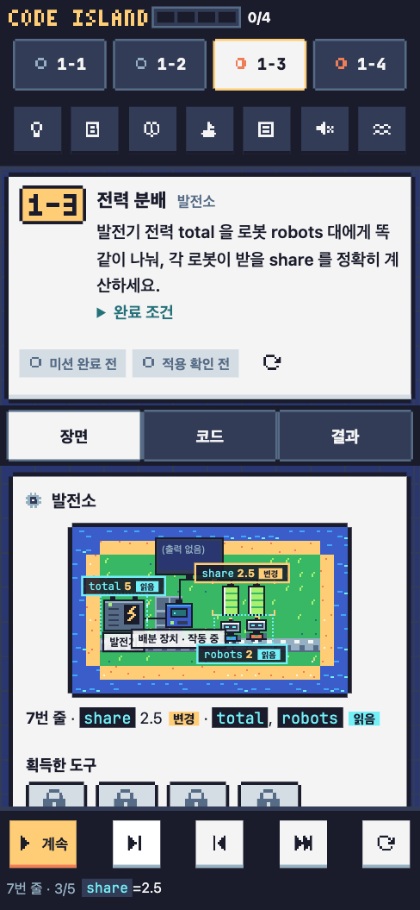

# C++ 코드섬: 로봇 복구대

C++를 처음 배우는 사람이 코드를 한 줄씩 실행하며 로봇과 시설이 어떻게 반응하는지 보고 문법과 사용 상황을 익히는 픽셀 아트 퍼즐 게임입니다. MIT OpenCourseWare [6.096 Introduction to C++](https://ocw.mit.edu/courses/6-096-introduction-to-c-january-iap-2011/)의 강의 순서를 따릅니다.

**[바로 플레이하기](https://kmmugyum.github.io/cpp-code-island/)** (설치 없이 브라우저에서 실행)



## 어떤 게임인가

고장 난 섬의 시설을 C++ 코드로 하나씩 복구합니다. 코드를 실행하면 실행 중인 줄, 장면에서 영향을 받은 대상, 변수 표의 바뀐 값이 함께 강조됩니다.

- **바뀐 값과 읽기만 한 값을 구분합니다.** `double share = 1.0 * total / robots;`를 실행하면 로봇 배터리(`share`)가 차오르고, 발전기(`total`)와 로봇 수(`robots`)에는 "읽음" 표시만 붙습니다.
- **출력은 상태를 바꾸지 않습니다.** `cout` 줄에서는 출력 화면만 바뀌고 장면의 다른 대상은 그대로입니다.
- **실행 전에 결과를 먼저 예상합니다.** `5 / 2`와 `5 / 2.0`의 출력을 고른 뒤 실행해 비교합니다.
- **다른 입력으로 다시 확인합니다.** 처음 입력에서만 맞는 답(예: `total / 2.0`)은 다른 발전기·로봇 수에서 틀린 것으로 드러납니다.
- **오답이면 고칠 곳으로 바로 이동합니다.** 원인이 된 빈칸이나 코드 줄에 포커스가 갑니다.

<p align="center"></p>

## 미션 (1장 시작 기지)

| 미션 | 내용 | 다루는 것 |
|---|---|---|
| 1-1 시동 순서 | 빌드 기계를 순서대로 연결해 기지 시동 | 소스, 전처리, 컴파일, 링크, 실행 |
| 1-2 신호 보내기 | 관제 화면에 `READY` 띄우기 | `main`, `cout`, `;`, 대소문자, `using namespace std` |
| 1-3 전력 분배 | 로봇에게 전력을 똑같이 나누기 | 정수/실수 나눗셈, `int`와 `double`, 계산 순서 |
| 1-4 기지 가동 | 입력받은 전력에서 사용량을 빼고 출력 | `cin >>`, 대입, 컴파일 오류 수정 |

섬 지도에는 6.096의 10개 강의가 모두 표시됩니다. 지금 플레이할 수 있는 것은 1장이고, 2장부터는 강의 순서대로 만들 예정입니다.

## 조작

| 조작 | 마우스·터치 | 키보드 |
|---|---|---|
| 실행 / 일시정지 | 아래 막대의 실행 버튼 | `K` |
| 한 단계 앞으로 / 뒤로 | 한 단계, 뒤로 | `N` / `B` |
| 처음 상태로 | 초기화 | `R` |
| 빈칸 채우기 | 코드의 ▢ 칸을 누르고 아래 코드 카드 선택 | `Tab`으로 이동, `Enter`로 선택 |
| 코드 편집 후 실행 (1-4) | 실행 버튼 | `Ctrl`/`⌘` + `Enter` |

드래그가 필요한 조작은 없습니다. 휴대폰에서는 [장면 / 코드 / 결과] 탭으로 화면을 나눠 봅니다. 효과음은 기본으로 꺼져 있고, 움직임 줄이기는 OS 설정과 상단 버튼을 함께 따릅니다.

<p align="center"></p>

## 진도와 기록

진도는 브라우저 저장소에 남습니다. 서버가 없으므로 튜터에게 보내려면 상단 **기록**에서 진도 파일(`.json`)이나 튜터용 요약(`.txt`)을 내려받아 전달합니다. 기록에는 미션 완료와 다른 입력 적용 확인, 마지막으로 연 힌트 단계, 오류 유형, 마무리 설명이 따로 남습니다.

## 실제 C++ 컴파일러가 아닙니다

게임 안의 실행기는 1장 문법(`#include <iostream>`, `int`/`double`/`char`/`bool`, 사칙연산과 `%`, 대입, `cin`, `cout`, `endl`, `return`)만 지원하는 교육용 시뮬레이터입니다. 미션에 나오는 모든 코드 조합의 출력과 컴파일/링크 오류 구분은 `clang++`(C++17) 실행 결과와 비교해 맞췄습니다. 초기화하지 않은 변수 읽기처럼 결과가 정해지지 않은 동작은 고정된 값을 보여 주지 않고 멈춰서 설명합니다.

## 개발

필요한 것: Node.js 22 이상 (외부 패키지 없음)

```bash
git clone https://github.com/kmmugyum/cpp-code-island.git
cd cpp-code-island
npm test          # 시뮬레이터와 미션 채점 테스트
npm run build     # dist/cpp-code-island.html 하나로 묶기
```

개발 중에는 `src/index.html`을 브라우저에서 바로 열면 됩니다. `npm run build`가 만든 `dist/cpp-code-island.html`은 CSS, 스크립트, 그래픽이 모두 들어 있는 단일 파일이라 파일 하나만 보내도 실행됩니다.

```
src/
  cppsim.js     1장 범위 C++ 시뮬레이터 (토큰화, 파싱, 단계별 실행 기록)
  missions.js   미션 데이터와 채점 (DOM 없음, Node 테스트에서 사용)
  pixel.js      팔레트, 스프라이트, 3x5 픽셀 글꼴, 아이콘
  scene.js      정수 배율 캔버스 장면 엔진과 미션별 장면
  sfx.js        WebAudio 효과음
  app.js        화면, 실행 제어, 진도 저장
tests/          node:test 테스트
build.mjs       단일 HTML 번들러
```

장면은 "현재 실행 단계"와 "그 단계가 시작된 뒤 흐른 시간"만으로 그립니다. 연타, 되감기, 초기화, 미션 이동을 해도 그림이 실행 기록과 어긋나지 않습니다.

## 출처와 라이선스

- 코드: [MIT License](./LICENSE)
- 강의: MIT OpenCourseWare, *6.096 Introduction to C++*, January IAP 2011. 강의 자료는 [CC BY-NC-SA 4.0](https://creativecommons.org/licenses/by-nc-sa/4.0/)이며 이 저장소에는 포함하지 않습니다. 게임의 "강의" 패널에는 해당 강의 노트의 짧은 원문 인용이 출처와 함께 들어 있습니다. 이 게임은 강의를 참고한 별도 교육 설계이며 MIT가 만들거나 승인한 것이 아닙니다.
- 그래픽과 소리: 외부 이미지·음원 파일 없이 `src/pixel.js`와 `src/sfx.js` 코드로 직접 그리고 합성했습니다. 색은 [Sweetie 16](https://lospec.com/palette-list/sweetie-16) 팔레트(GrafxKid)의 16색을 씁니다.
